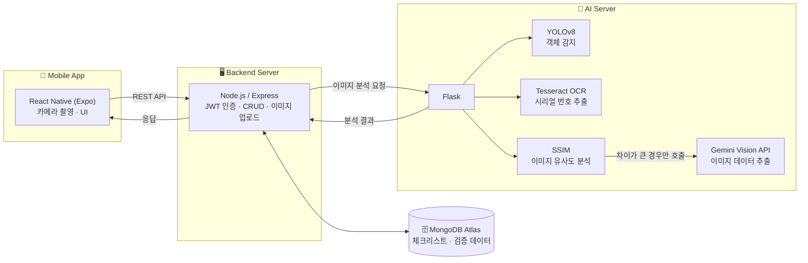
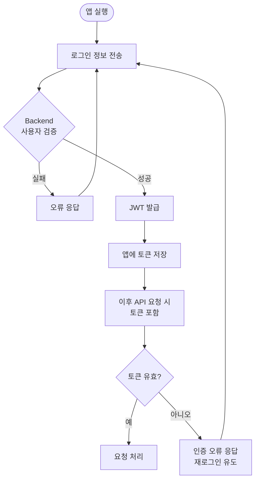
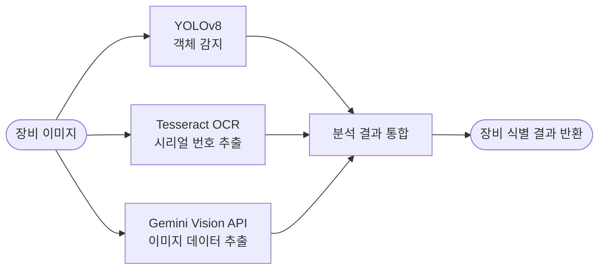
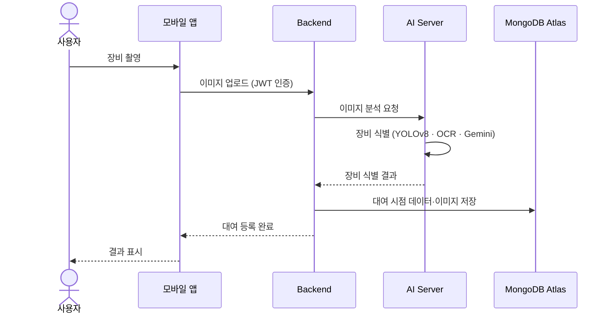
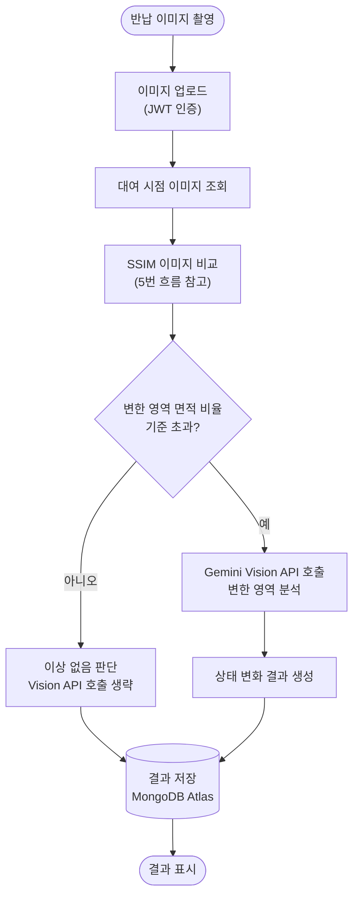
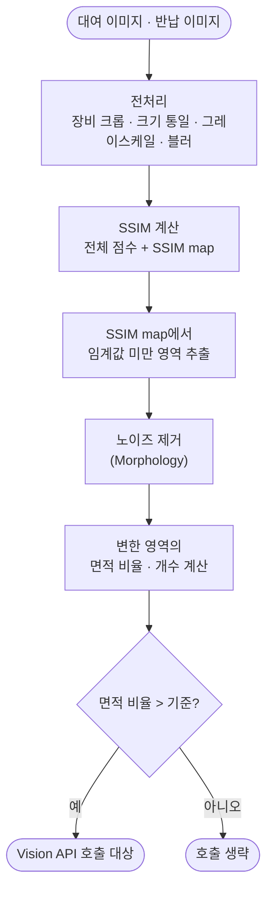

# 📦 AI 기반 장비 대여·반납 자동 확인 시스템

> 카메라 촬영만으로 장비를 식별하고, 대여 시점과 반납 시점의 이미지를 비교해 **장비 상태 변화를 자동으로 확인**하는 AI 기반 모바일 애플리케이션

| 항목 | 내용 |
| --- | --- |
| **진행 기간** | 2025.03 ~ 2026.01 |
| **역할** | 프로젝트 기획, 시스템 설계, 전체 개발 (1인 개발) |
| **구조** | Mobile App → Backend → AI Server (3계층) |

---

## 📌 목차

1. [프로젝트 소개](#-프로젝트-소개)
2. [문제 정의 및 목표](#-문제-정의-및-목표)
3. [기술 스택](#-기술-스택)
4. [시스템 아키텍처](#-시스템-아키텍처)
5. [핵심 기능 및 처리 흐름](#-핵심-기능-및-처리-흐름)
6. [주요 구현 내용](#-주요-구현-내용)
7. [결과](#-결과)

---

## 📖 프로젝트 소개

카메라, 스마트폰, 노트북 등 **전자기기의 대여 및 반납 과정을 개선**하기 위해 개발한 AI 기반 모바일 애플리케이션 시스템입니다.

- 카메라 촬영을 통해 **대여 대상 장비를 식별**
- 대여 시점과 반납 시점의 **이미지를 비교**하여 장비의 **상태 변화를 확인**
- MongoDB Atlas 기반 데이터 관리로 모든 절차에서 **사용자 편의성** 추구

---

## 🎯 문제 정의 및 목표

### 기존 방식의 한계

기존 대여 시스템은 QR코드·바코드를 통한 **장비 식별**에 의존합니다. 그래서 외관상 손상이나 상태 변화를 확인하려면 **별도의 육안 검수 절차**가 필요했습니다.

### 목표

| 기존 | 개선 |
| --- | --- |
| QR/바코드로 장비 식별 | AI 객체 인식 + OCR로 자동 식별 |
| 담당자의 육안 검수 | 이미지 비교(SSIM) + Vision AI로 상태 확인 자동화 |
| 검수 부담 집중 | 담당자의 검수 부담 감소 |

---

## 🛠 기술 스택

| 영역 | 기술 |
| --- | --- |
| **Mobile App** | React Native (Expo) |
| **Backend** | Node.js, Express, JWT |
| **AI Server** | Python, Flask |
| **Database** | MongoDB Atlas |
| **AI / Vision** | YOLOv8 (객체 감지), Tesseract OCR (시리얼 번호), Gemini Vision API (이미지 데이터 추출), SSIM (이미지 유사도) |

---

## 🏗 시스템 아키텍처

3계층 구조로 설계했습니다. 앱은 AI 서버와 직접 통신하지 않고, 모든 요청을 백엔드를 거쳐 처리합니다.

### 계층별 역할

| 계층 | 역할 |
| --- | --- |
| **Mobile App** | 장비 촬영, 대여/반납 절차 진행, 결과 확인 |
| **Backend** | 사용자 인증(JWT), 체크리스트·검증 데이터 CRUD, 이미지 업로드 처리, AI 서버 연동 |
| **AI Server** | 객체 감지, OCR, 이미지 유사도 분석, Vision API 호출 |

---

## 🔄 핵심 기능 및 처리 흐름

시스템은 아래 6개 흐름으로 구성됩니다.

| # | 흐름 | 담당 |
| --- | --- | --- |
| 1 | 사용자 인증 | App · Backend |
| 2 | 장비 식별 | AI Server |
| 3 | 장비 대여 | App · Backend · AI Server |
| 4 | 장비 반납 및 상태 비교 | App · Backend · AI Server |
| 5 | SSIM 이미지 비교 (상세) | AI Server |
| 6 | 백엔드 요청 처리 | Backend |

> 아래 흐름도는 구조를 설명하기 위한 것입니다. 실제 호출 순서·조건과 다르면 코드 기준으로 수정해 주세요.

### 1. 사용자 인증 흐름 (JWT)

### 2. 장비 식별 흐름 (AI Server)

촬영된 장비 이미지에서 **객체 · 시리얼 번호 · 이미지 데이터**를 각각 추출해 하나의 식별 결과로 합칩니다.

### 3. 장비 대여 흐름

### 4. 장비 반납 및 상태 비교 흐름

반납 이미지를 대여 시점 이미지와 비교합니다. **SSIM으로 변한 영역을 먼저 찾고**, 변화가 의심될 때만 Gemini Vision API를 호출합니다.

### 5. SSIM 이미지 비교 상세

SSIM은 **판정 도구가 아니라 Vision API 호출 전 1차 필터**입니다. 전체 점수 하나가 아니라, 이미지의 어느 부분이 달라졌는지 보여주는 **SSIM map**을 활용합니다.

| 단계 | 목적 |
| --- | --- |
| 장비 크롭 · 크기 통일 | 배경·촬영 거리 차이로 인한 오차 감소 |
| 블러 | 미세한 노이즈로 인한 오탐 감소 |
| SSIM map 활용 | 평균 점수에 묻히는 국소적 변화(스크래치 등) 포착 |
| 면적 비율 기준 | Vision API를 호출할지 결정하는 1차 필터 |

> 임계값과 면적 비율 기준은 정상 쌍·손상 쌍 샘플의 점수 분포를 측정해 정할 예정입니다.

## 💡 주요 구현 내용

### 1. 모바일 애플리케이션 (React Native)
- React Native(Expo) 기반 모바일 앱 풀스택 개발
- 카메라 촬영을 통한 장비 이미지 획득 및 대여·반납 절차 UI 구현

### 2. 백엔드 (Node.js / Express)
- JWT 기반 사용자 인증
- MongoDB 체크리스트·검증 데이터 CRUD
- 이미지 업로드 처리 및 AI 서버 연동

### 3. AI 서버 (Flask)
- **YOLOv8**: 간단한 객체 감지를 통한 장비 식별
- **Gemini Vision API**: 촬영된 이미지에서 데이터 추출
- **Tesseract OCR**: 시리얼 번호 추출

### 4. 영상처리 기반 API 효율화
- **SSIM** 기반 이미지 유사도 분석으로 이미지 간 차이를 수치화
- 변한 영역의 면적 비율에 따라 **Gemini Vision API 호출 대상을 선별**하여 API 사용 효율 개선

---

## ✅ 결과

- **앱 → 백엔드 → AI 서버**로 이어지는 3계층 구조를 설계하고 연동을 완료했습니다.
- 장비 식별부터 대여·반납 시점 비교까지 하나의 흐름으로 자동화하여, 육안 검수에 의존하던 절차를 AI 기반으로 보완했습니다.

## 시연 영상

https://github.com/user-attachments/assets/d983826f-a66f-445b-b336-704676ad6d70

---

## 📄 License

This project was developed as a graduation project at Kunsan National University.
